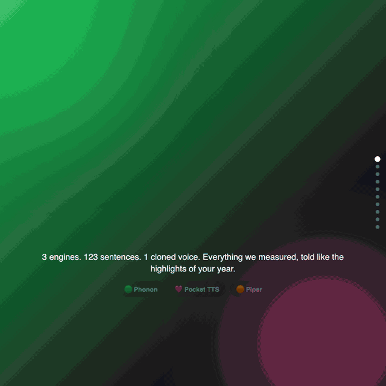

# realtime-tts-es-bench

Benchmark of real-time Spanish text-to-speech engines for call center use.



The animation above summarizes the results. Interactive version: [`results/wrapped.en.html`](results/wrapped.en.html). Full analysis: [`results/engine-selection.md`](results/engine-selection.md).

- [Engines](docs/engines.md) and [adding an engine](docs/adding-an-engine.md)
- [Voice preparation and consent](docs/voice-preparation.md)
- [Real-time performance metrics](docs/metrics.md): TTFA, RTF, throughput, load time, resources, and how to compare runs
- [Speaker similarity and consistency metrics](docs/speaker-similarity.md): cloned-voice similarity to the reference, repetition consistency, and the Spanish EER check
- [Intelligibility metrics (WER and CER)](docs/intelligibility.md): speech recognizer based accuracy per engine, Spanish normalization, and how to compare runs

## Intelligibility metrics: recognizer environment

Only the `transcribe` stage needs a speech recognizer. Keep it in its own environment so engine environments stay unchanged:

```
python3.11 -m venv .venv-asr
.venv-asr/bin/pip install -e ".[asr]"
```

`synthesize` runs in the engine's environment, `transcribe` in `.venv-asr`, and `score`, `compare` and `errors` in any environment (they use only the standard library and numpy). The `--model fake` option needs no recognizer.

## Speaker similarity metrics: embedding environment

Only the `embed` stage needs a speaker-embedding model. Keep it in its own environment:

```
python3.11 -m venv .venv-spk
.venv-spk/bin/pip install -e ".[speaker]"
```

`synthesize` runs in the cloning engine's environment, `embed` in `.venv-spk`, and `score` and `compare` in any environment (standard library and numpy only). The `--model fake` option needs no model. See [docs/speaker-similarity.md](docs/speaker-similarity.md).

## Real-time backend

The backend gateway needs `fastapi` and `uvicorn` (optional extra) and `httpx` for its tests. Install them into `.venv-core`:

```bash
.venv-core/bin/pip install -e ".[dev,backend]"
```

Start it with `.venv-core/bin/python -m tts_bench.backend serve` (http://127.0.0.1:8000; `/v1/health`, `/v1/engines`, `WS /v1/ws/synthesize`, `POST /v1/synthesize`). Tests need no weights: `.venv-core/bin/python -m pytest tests/backend -q`.

Engines keep their own virtual environments; the gateway starts one worker per engine in that engine's venv (see `docs/backend.md`).

See [docs/backend.md](docs/backend.md) for the real-time backend (endpoints, metric definitions, limits).
